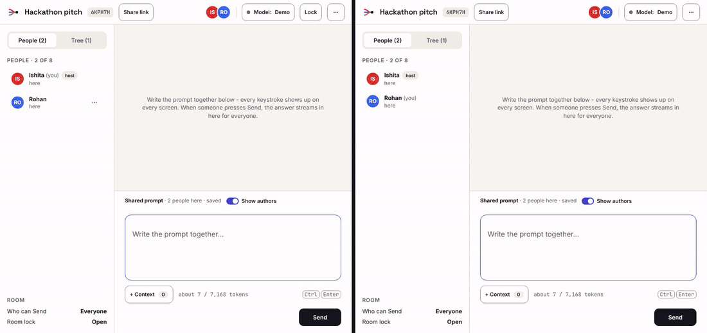
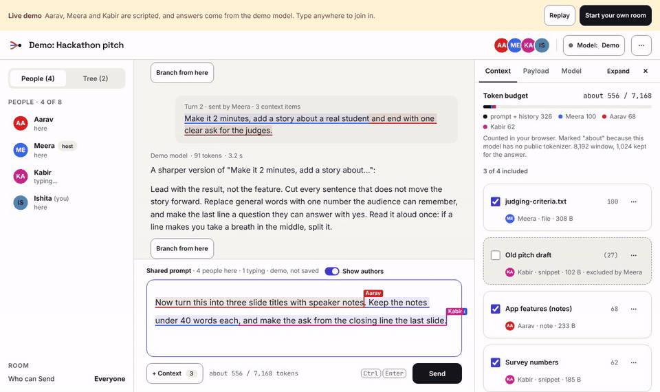

<p align="center">
  
</p>

<h1 align="center">PromptAlong</h1>

<p align="center"><strong>Everyone prompts. One answer.</strong><br>
Like a sing-along, but for AI.</p>

<p align="center">
  <a href="https://promptalong.vercel.app/demo"><strong>Try the live demo</strong></a> ·
  <a href="https://promptalong.vercel.app">Start a room</a> ·
  <a href="docs/case-study.md">Case study</a> ·
  <a href="docs/architecture.md">Architecture</a>
</p>

PromptAlong is a real-time multiplayer prompting workspace. Several people co-write **one**
prompt with live cursors, one person presses **Send**, and everyone watches the **same** answer
stream in. It works with any model, including free ones, and costs nothing to run.

Student teams, hackathon teams and study groups usually work on separate machines and separate
AI accounts, copy-pasting prompts and answers back and forth. PromptAlong gives them one shared
prompt, one shared answer and one shared history.


<sub>The live demo at <a href="https://promptalong.vercel.app/demo">/demo</a>: three scripted
teammates and you, in a room that lives only in your browser. No sign-up, no key.</sub>

## What makes it different

1. **Shared prompt, shared stream** - multi-cursor editing of one prompt (CRDT), one Send, one
   token stream that every participant sees live.
2. **Prompt provenance** - every part of the prompt keeps its author; branch, fork, compare and
   merge the conversation like code.
3. **Context transparency** - everyone attaches their own context, and a panel shows exactly
   what the model will receive, byte for byte, with a live token budget.
4. **Any model, zero cost** - a scripted demo model, your own key (kept in your browser), a model
   running in your browser (WebGPU), or one running on your laptop (Ollama).

### Two people, one room



Two separate browsers in one room: each sees the other's caret and name, both type at the same
time, and the text is coloured by who wrote it. One Send, and the same answer streams in on both.

### What the model sees, and where the conversation went



The **Payload** tab is the exact string Send will post (same function, same bytes, same hash).
The **Tree** tab shows every turn with its authors and model, branches, compare and merge.

## How it works

- One [Yjs](https://yjs.dev) document per room holds the prompt, the turns, the branches and the
  context. Edits travel as small CRDT updates over a private Supabase Realtime channel, so two
  people typing at the same spot never lose a letter; each browser also keeps the room offline.
- Only the sender's browser calls the model. It appends the answer to the turn in the shared
  document every ~150 ms, so everyone sees one stream - without anyone sharing a key.
- A send lock with a heartbeat makes sure two Sends at the same moment reach the model once.
- One pure function assembles the request; the panel shows its output and Send posts it.
- Rooms are saved as snapshots in Postgres behind row-level security; every write goes through
  a checked SQL function. People sign in anonymously - no email needed.

More in [docs/architecture.md](docs/architecture.md); the story behind the decisions is in
[docs/case-study.md](docs/case-study.md).

## Stack

Vite, React 19, TypeScript (strict), React Router, Tailwind CSS v4, Radix UI, Yjs, TipTap,
Supabase (Realtime, Postgres with RLS, anonymous auth), WebLLM, Vitest, Playwright, axe-core.
Hosted on Vercel. Everything runs on free tiers.

```
apps/web            the app
packages/core       room model, sync, provenance, conversation tree, context assembly
packages/providers  model provider interface and backends
packages/ui         design tokens and components
packages/config     shared TypeScript / ESLint / Prettier / Tailwind config
packages/db         tests of the database rules on an in-process Postgres
supabase/           migrations, RLS policies and the local stack config
e2e/                Playwright tests
docs/               architecture, case study, runbooks
```

## Tested

- 245 unit tests (Vitest) across the packages, and 80 end-to-end tests (Playwright) that run in
  Chromium, Firefox and WebKit with two to nine separate browsers per test: people typing at the
  same spot at once, a network cut and reconnect, one Send seen by everyone, a model key that
  never leaves its browser, the panel's payload equal to the request body, branch / fork / merge,
  room rules, the live demo, and axe accessibility checks on every page.
- Every end-to-end test runs under the production Content-Security-Policy.
- Budgets: first-load JavaScript 104.5 KB gzip (limit 200), keystroke to another screen under
  300 ms, a streamed token on every screen under 1 s, Lighthouse 88-100.
- CI blocks a merge on lint, types, formatting, tests, the build, the JavaScript budget and the
  licence allow-list.

## Run it locally

Requirements: Node 22+ and pnpm (the version is pinned in `package.json`; with Corepack run
`corepack enable`).

```bash
pnpm install
pnpm relay               # terminal 1: local sync relay on ws://localhost:8787
pnpm dev                 # terminal 2: http://localhost:5173
```

Open the same room link in two browsers (or a normal and a private window) to write together.
The relay stands in for the hosted backend with the same room rules, kept in memory (rooms are
forgotten when it stops). Without it the app still works, but each browser only sees its own copy.

Useful scripts:

| Command                                                 | What it does                                                                               |
| ------------------------------------------------------- | ------------------------------------------------------------------------------------------ |
| `pnpm test`                                             | unit tests (Vitest) in every package                                                       |
| `pnpm lint` / `pnpm typecheck`                          | ESLint / TypeScript                                                                        |
| `pnpm build`                                            | production build of the app                                                                |
| `pnpm exec playwright install chromium` then `pnpm e2e` | end-to-end tests: 2-9 browsers writing together, offline/reconnect, latency, accessibility |
| `pnpm check`                                            | every CI gate except E2E                                                                   |

Environment variables are listed in [`.env.example`](.env.example). Locally nothing is needed: rooms
sync through the relay. With `VITE_SUPABASE_URL` and `VITE_SUPABASE_ANON_KEY` set, the app uses that
Supabase project: anonymous sign-in, rooms and snapshots in Postgres behind row-level security, and a
private Realtime channel per room. Setting one up is described in
[docs/runbooks/database.md](docs/runbooks/database.md); deploying in
[docs/runbooks/deploy.md](docs/runbooks/deploy.md).

## Privacy

Your model key never leaves your browser: it is not synced to other people, not sent to any
PromptAlong server, and not logged. Only your browser talks to the model provider you choose.
No table in the database has a column for a key.

The live demo runs entirely in your browser: nothing in it is sent anywhere or saved.

Anyone with a room's code can join it until the host locks it. People in a room can read
everything in it, so do not paste secrets into a shared prompt.

## Team

Built by Shubhranshu Sahu and Sidak Kaur Gurpreet Singh Sachdev.

## Licence

[MIT](LICENSE) © 2026 Shubhranshu Sahu
